  

  

  
  
  
  

---

### About

I'm a Full-Stack Software Engineer passionate about building clean, responsive, and practical software. I work across modern frontend interfaces, backend APIs, databases, and integrations, while exploring AI and automation to solve real-world problems. I enjoy learning by building, sharing knowledge, and turning ideas into useful digital products.

<table>
  <tr>
    <td width="50%" valign="top">
      <b>Working on</b> 
      Full-stack web applications, REST APIs, and practical software projects.
    </td>
    <td width="50%" valign="top">
      <b>Learning</b> 
      AI integration, software architecture, backend engineering, and automation.
    </td>
  </tr>
  <tr>
    <td width="50%" valign="top">
      <b>Collaborating on</b> 
      Open-source projects, developer tools, AI-powered applications, and meaningful web products.
    </td>
    <td width="50%" valign="top">
      <b>Looking for help with</b> 
      Building scalable applications, improving system design, and adopting software engineering best practices.
    </td>
  </tr>
</table>

**Ask me about:** React, Next.js, JavaScript, Python, Flask, Node.js, PostgreSQL, REST APIs, and responsive UI development. 
**Pronouns:** He/Him 
**Fun fact:** I enjoy turning ideas into working software, and finding out what breaks along the way.

---

### Tech Stack

**Languages** 

  

**Frontend** 

  

**Backend & APIs** 

  

**Data & AI** 

  

**Databases** 

  

**Cloud & DevOps** 

  

**Tools** 

  

---

### GitHub Stats

  
  

### Contribution Graph

  

  

